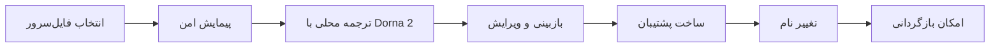

# Ariana File Server

> Safe, local and AI-assisted Persian-to-English file renaming for Windows file servers.

**توسعه‌دهنده: [Mohamad Milad](https://github.com/mohamadmilad1)**


[Screenshot omitted from the public repository for privacy.]

## برای مدیران شبکه‌ای که با انبوه فایل‌های فارسی روبه‌رو هستند

اگر مدیریت یک فایل‌سرور سازمانی را بر عهده دارید، احتمالاً با هزاران پوشه و فایل فارسی، نام‌های نامنظم و ساختارهایی مواجه شده‌اید که جست‌وجو، انتقال بین سامانه‌ها، تهیه آرشیو و استفاده در نرم‌افزارهای بین‌المللی را دشوار می‌کنند. تغییر دستی این نام‌ها زمان‌بر است و یک اشتباه کوچک می‌تواند مسیر فایل‌ها یا روند کاری کاربران را مختل کند.

**آریانا فایل سرور** این فرایند را به‌صورت گروهی، کنترل‌شده و قابل بازگشت انجام می‌دهد. برنامه کل ساختار انتخاب‌شده را پیمایش می‌کند، برای نام‌های فارسی معادل انگلیسی مناسب پیشنهاد می‌دهد و پیش از هر تغییری نتیجه را در اختیار مدیر شبکه می‌گذارد. پس از تأیید، پشتیبان کامل JSON و Excel ساخته می‌شود و عملیات تغییر نام با امکان Restore اجرا می‌گردد.

پردازش هوش مصنوعی روی همان رایانه و با مدل محلی **Dorna 2** انجام می‌شود؛ بنابراین نام فایل‌ها، مسیر پروژه‌ها و اطلاعات سازمان برای ترجمه به سرویس اینترنتی ارسال نمی‌شوند. برنامه ابتدا از NVIDIA GPU استفاده می‌کند و در صورت نیاز از CPU و RAM کمک می‌گیرد.

## قابلیت‌های اصلی

- ترجمه گروهی نام فایل‌ها و پوشه‌های فارسی به انگلیسی
- اجرای مستقیم Dorna 2 با `llama.cpp` و بدون نیاز به Ollama
- استفاده خودکار از GPU و ادامه پردازش با CPU/RAM
- پیش‌نمایش کامل و ویرایش دستی پیش از تغییر نام
- ساخت پشتیبان JSON و Excel پیش از اجرا
- بازگردانی نام‌ها با یک فایل manifest
- جلوگیری از overwrite، برخورد نام و نام‌های غیرمجاز ویندوز
- تشخیص تغییر فایل‌ها بین Scan و Rename
- پشتیبانی از مسیرهای محلی و UNC ویندوز
- نادیده‌گرفتن فایل‌های قفل موقت Microsoft Office
- رابط فارسی راست‌به‌چپ با طراحی مناسب محیط‌های سازمانی

## روند کار



1. پوشه اصلی یا مسیر شبکه را انتخاب کنید.
2. **پیمایش** را بزنید تا فهرست فایل‌ها بدون تغییر ساخته شود.
3. با **ترجمه و پیش‌نمایش** پیشنهادهای انگلیسی را دریافت کنید.
4. پیشنهادها را بررسی کنید و موارد لازم را دستی اصلاح کنید.
5. **تهیه پشتیبان** را اجرا کنید.
6. تأیید بازبینی را فعال و **اجرای تغییر نام** را انتخاب کنید.
7. هر زمان لازم بود، با فایل manifest نام‌ها را بازگردانید.

## نصب در Windows

پیش‌نیاز پیشنهادی، Python 3.11 نسخه ۶۴ بیتی است. برای شتاب GPU، کارت NVIDIA و درایور به‌روز نیاز است.

```text
1. install_dorna_gpu.bat را اجرا کنید.
2. منتظر بمانید تا محیط برنامه و مدل آماده شوند.
3. launch.bat را اجرا کنید.
```

مدل Dorna 2 حدود ۴٫۹۲ گیگابایت است و داخل مخزن GitHub قرار نمی‌گیرد. نصب‌کننده مدل را روی رایانه مقصد دریافت و صحت آن را بررسی می‌کند. اگر CUDA در دسترس نباشد، برنامه به‌صورت خودکار از CPU/RAM استفاده خواهد کرد.

## معماری

- **Desktop UI:** Python, CustomTkinter and Tkinter
- **Local inference:** llama-cpp-python, CUDA 12.4 and CPU fallback
- **Model:** Dorna 2 Llama 3.1 8B Instruct GGUF
- **Recovery:** JSON manifest and Excel inventory
- **Testing:** Python unittest; 35 automated tests

## آزمون‌ها

```powershell
.\.venv\Scripts\python.exe -m unittest -v test_engine test_gui test_translator test_direct_dorna test_ui_text
```

## حریم خصوصی و ایمنی

فایل‌ها برای ترجمه آپلود نمی‌شوند و پردازش مدل کاملاً محلی است. برنامه پیش از Rename وضعیت فایل‌ها را دوباره کنترل می‌کند، از جایگزینی ناخواسته جلوگیری می‌کند و برای هر عملیات یک مسیر بازگشت نگه می‌دارد. با این حال، مدیر سیستم باید پیش‌نمایش را بررسی کند و برنامه را ابتدا روی یک کپی آزمایشی از داده‌ها اجرا کند.

## محتوای مخزن GitHub

کد برنامه، آزمون‌ها، نصب‌کننده‌ها، واژه‌نامه و مستندات در مخزن قرار می‌گیرند. موارد زیر عمداً با `.gitignore` حذف شده‌اند:

- فایل مدل GGUF
- پوشه `.venv`
- مدل‌های دانلودشده
- cache، log و فایل‌های موقت اجرا

## Developer

Designed and developed by **Mohamad Milad**<br>
GitHub: [@mohamadmilad1](https://github.com/mohamadmilad1)

## License

This project is released under the MIT License. The Dorna/Llama model weights are distributed separately and remain subject to their own licenses.
